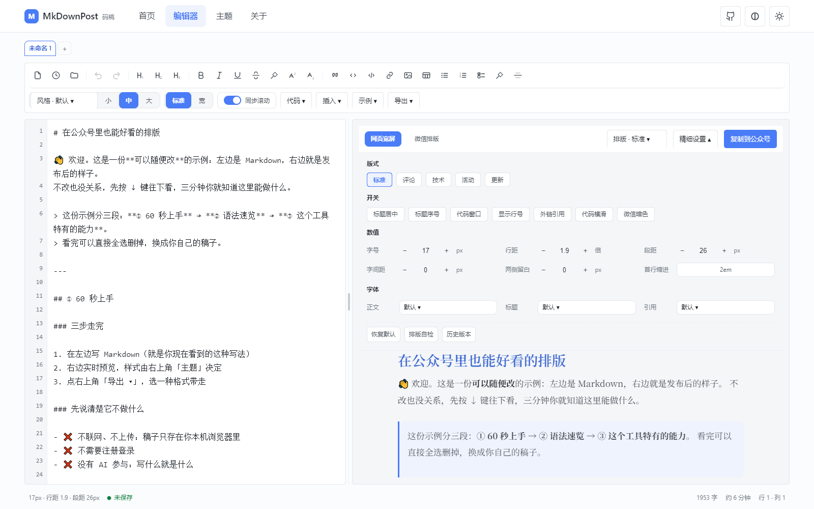
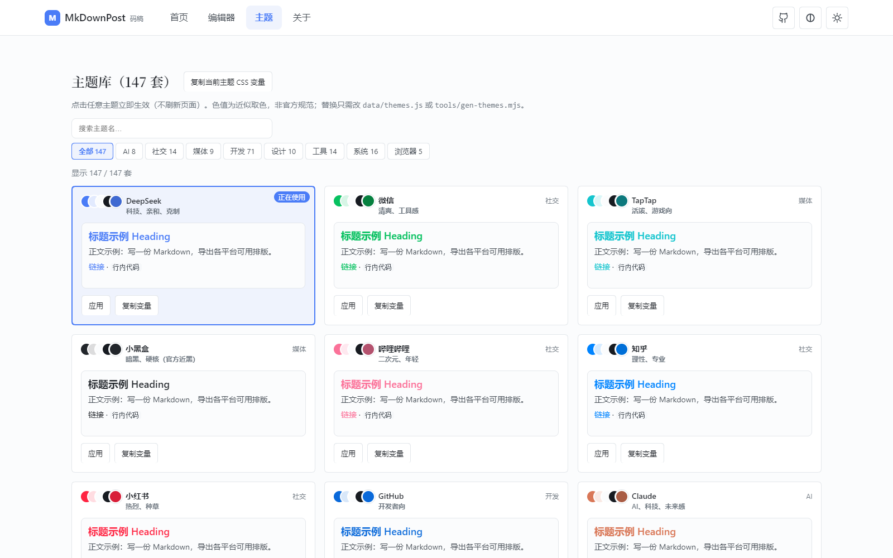
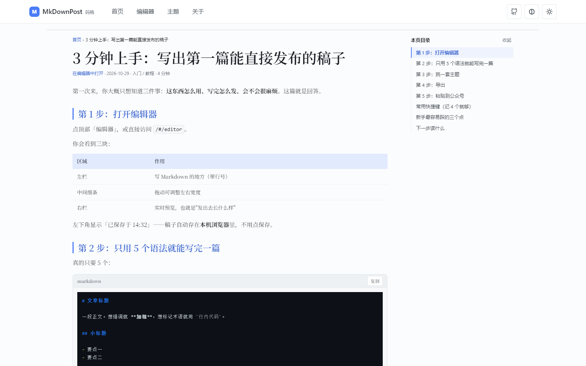

# MkDownPost · 码稿

写 Markdown，一键变成能直接粘进公众号后台的排版。零构建、纯前端、内容不上传。

[](https://github.com/YunDaiShu/MkDownPost/actions/workflows/site-health.yml)
[](https://yundaishu.github.io/MkDownPost/)
[](#主题)
[](#技术选择)
[](LICENSE)


---

## 这是什么

左边写 Markdown，右边就是公众号里的样子。写完点一下「复制到公众号」，粘进后台草稿箱，样式跟着走。

- **147 套主题** —— 品牌配色按明暗双色提供，所有元素随主题联动
- **微信排版面板** —— 字号、行距、段距、字间距、两侧留白、首行缩进，全部可视化调
- **多平台导出** —— 公众号全内联样式、小黑盒结构、TapTap 兼容降级
- **不上传、无账号、无 AI** —— 稿子只存在你本机浏览器里

## 界面

| 编辑器：左写右排 | 微信排版精细设置 |
|---|---|
|  | 见上图右侧面板 |

| 主题库（147 套） | 文章页（长文阅读） |
|---|---|
|  |  |

## 快速开始

**在线用**：<https://yundaishu.github.io/MkDownPost/>

**本地跑**（ES Module 必须走 http，不能双击打开 index.html）：

```bash
npm run serve          # 起一个零依赖静态服务器
# 然后打开终端提示的地址
```

没有 `npm install` —— 这个项目没有运行时依赖。

## 功能

| 功能 | 说明 |
|---|---|
| 实时预览 | 左编辑右渲染，同步滚动可开关 |
| 主题 | 147 套，8 个分类（AI / 社交 / 媒体 / 开发 / 设计 / 工具 / 系统 / 浏览器），明暗双色 |
| 设计风格 | 8 种叠加层（瑞士 / 苹果 / 宜家 / 博朗 / 包豪斯 / 无印 / Material / Linear），只改形式不动配色 |
| 排版设置 | 字号 12–22、行距 1.3–2.6、段距、字间距、留白、首行缩进；5 档版式预设 |
| 微信增强 | 标题居中、标题序号、代码块 Mac 窗口、行号、外链引用、代码横滑、微信暗色模拟 |
| 导出 | Markdown / HTML / 长图 / 公众号剪贴板 |
| 编辑器 | 20 个行内动作、6 个插入模板、示例模板、多标签页、本地历史（20 个快照） |
| 隐私 | 全部数据在 `localStorage`，无后端、无统计、无 AI |

## 技术选择

| 决定 | 原因 |
|---|---|
| **零构建** | 没有打包器、没有 node_modules，改完刷新就生效，十年后还能跑 |
| **纯 ES Module** | 浏览器原生模块，50 个文件按需加载，路由级懒加载 |
| **localStorage** | 草稿、主题、排版参数都存在本机，不经过任何服务器 |
| **CSS 令牌** | 颜色/间距/圆角/字号全部走 `:root` 变量，换主题只换变量 |

## 项目结构

```
MkDownPost/
├── index.html              单页外壳（内联首屏 CSS + 预加载清单）
├── sw.js                   Service Worker（导航/代码网络优先，图片字体缓存优先）
├── src/
│   ├── main.js              启动、主题恢复、路由挂载
│   ├── router.js            hash 路由（#/ #/editor #/themes #/about #/article/:slug）
│   ├── theme-manager.js     主题应用（CSS 变量注入）
│   ├── theme-custom.js      自定义主色
│   ├── editor/              编辑器（editor-page.js / keymap.js）
│   ├── markdown/            Markdown 解析与渲染（自研解析器 + 可选第三方渲染）
│   ├── pages/               页面（首页 / 主题页 / 关于 / 文章）
│   ├── components/          组件（主题切换器、快捷键面板…）
│   ├── adapters/            平台适配（公众号 / 小黑盒 / TapTap）
│   └── fx/                  装饰动效
├── data/
│   ├── themes.js            主题入口（手写 8 套 + 生成 139 套 = 147）
│   └── themes.generated.js  由 tools/gen-themes.mjs 生成，勿手改
├── assets/styles/           19 个 CSS 源文件 + 构建产物（critical / rest / *.lazy）
├── content/                 文章源（Markdown）
├── docs/images/             README 截图与图标
├── tests/                   node:test 单测
└── tools/                   41 个零依赖脚本（见下表）
```

## 工具脚本（`tools/`）

这些脚本全部零依赖，用 Node 直接跑。**CI 会跑其中一部分**，本地跑一遍就能复现 CI 结果。

| 脚本 | 干什么 |
|---|---|
| `serve.mjs` | 本地静态服务器（`npm run serve`） |
| `build-seo.mjs` | 生成静态文章页、sitemap、结构化数据 |
| `bundle-css.mjs` | 拆 critical（内联）+ rest（非阻塞）+ 编辑器/主题懒加载包 |
| `stamp-version.mjs` | 内容哈希版本戳，缓存击穿 + SW 更新（`--check` 供 CI 校验） |
| `gen-modulepreload.mjs` | 按静态依赖图生成 `<link rel="modulepreload">` |
| `check-artifacts.mjs` | 校验构建产物与源文件一致 |
| `check-imports.mjs` | 校验所有相对 import 指向真实文件 |
| `check-interaction.mjs` | 交互规范（层叠顺序 / hover / 焦点 / 图标配平 / 明暗对比度） |
| `check-scale.mjs` | 设计尺度（字号档位 / 4px 间距栅格 / 圆角 / 字重） |
| `check-themes-schema.mjs` | 主题数据结构与重复 key |
| `lint-hardcoded-color.mjs` | 组件样式里不许出现硬编码颜色 |
| `test-editor.mjs` | **编辑器功能冒烟测试**（无头 Edge 真点 33 项） |
| `smoke-md.mjs` | Markdown 解析冒烟 |
| `audit-responsive.mjs` | 多分辨率回归 |
| `shot.mjs` | 任意视口截图（自带无头 Edge + CDP） |
| `gen-themes.mjs` | 生成扩展主题 |
| `vendor.mjs` | 一次性下载第三方库到 `vendor/`（运行时不联网） |

常用组合：

```bash
npm run check          # 导入完整性
npm run test           # 主题数据单测
npm run test:editor    # 编辑器 33 项冒烟
npm run lint:color     # 硬编码颜色
npm run audit          # 多分辨率回归
```

## 主题

147 套，8 个分类，每套提供 light/dark 两个 brand 色。手写 8 套 + `tools/gen-themes.mjs` 生成 139 套；生成的清单不要手改。

数据结构与校验：

```bash
npm run check:themes
```

## 数据存储

全部在浏览器本地，键名以 `mdp:v1:` 开头：

| 键 | 内容 |
|---|---|
| `mdp:v1:draft` | 当前草稿 |
| `mdp:v1:theme` / `mdp:v1:style` / `mdp:v1:code-theme` | 主题、设计风格、代码配色 |
| `mdp:v1:wxlayout` / `mdp:v1:wxopts` / `mdp:v1:wxp` | 微信排版参数 |
| `mdp:v1:wxhist` | 排版历史（20 个快照） |
| `mdp:v1:tabs` | 多标签页 |
| `mdp:v1:split` | 分栏比例（默认 42/58） |

清除方法：浏览器设置里删掉本站数据，或在控制台执行 `localStorage.clear()`。

## 常见问题

**刷新后界面还是旧的？**
Service Worker 已改成代码/样式网络优先，普通刷新即可；极端情况按 `Ctrl+Shift+R`。

**复制到公众号后样式丢了？**
公众号会过滤 class，所以导出的 HTML 是**全内联样式**。粘贴时请用「保留格式」而不是纯文本。

**能不能处理图片？**
支持图片语法与图床链接；公众号对图片有尺寸和格式要求，导出时会给出提示。

**为什么没有 AI 功能？**
刻意的。这个工具只做排版，不替你写，也不联网。

## 许可

MIT，见 [LICENSE](LICENSE)。非官方工具，与各平台无隶属关系。

---

如果这个工具省了你的时间，给个 Star 就够了。
