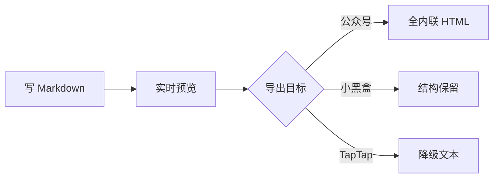
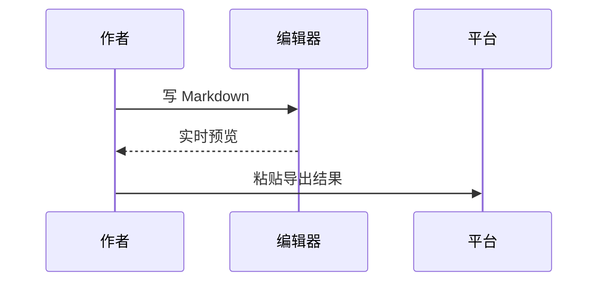

# 图表与公式

## 流程图

## 时序图

## 行内公式

质能方程 $E = mc^2$，以及二次方程求根公式 $x = \frac{-b \pm \sqrt{b^2-4ac}}{2a}$。

## 块级公式

$$
\int_{-\infty}^{\infty} e^{-x^2} dx = \sqrt{\pi}
$$

> 若本机没有下载 Mermaid / KaTeX 库，图表会显示源码、公式保留原始写法，正文不受影响。
