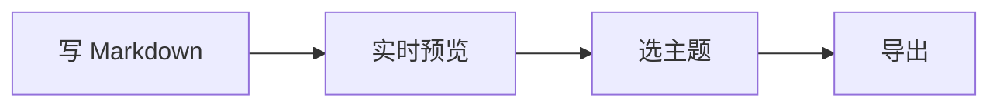

# 在公众号里也能好看的排版

👋 欢迎。这是一份**可以随便改**的示例：左边是 Markdown，右边就是发布后的样子。
不改也没关系，先按 ↓ 键往下看，三分钟你就知道这里能做什么。

> 这份示例分三段：**① 60 秒上手** → **② 语法速览** → **③ 这个工具特有的能力**。
> 看完可以直接全选删掉，换成你自己的稿子。

---

## ① 60 秒上手

### 三步走完

1. 在左边写 Markdown（就是你现在看到的这种写法）
2. 右边实时预览，样式由右上角「主题」决定
3. 点右上角「导出 ▾」，选一种格式带走

### 先说清楚它不做什么

- ❌ 不联网、不上传：稿子只存在你本机浏览器里
- ❌ 不需要注册登录
- ❌ 没有 AI 参与：写什么就是什么

### 试试这些（不用记，随手点）

- 点右上角 🎨 **主题**，换一套配色，全站跟着变
- 点 ☀️ / 🌙 切换明暗，看右侧实时变化
- 按 **?** 打开快捷键面板
- 点「导出 ▾」，试试 **PNG 长图** 和 **PDF**

---

## ② 语法速览

下面每一条都是「能直接抄」的写法。不用背，用到了回来找。

### 强调：加粗、斜体、删除线

**加粗**用来标记结论，*斜体*用来标记术语，~~删除线~~用来留修订痕迹。
一行里的代码用 `行内代码` 包住，比如 `npm run dev`。

> 💡 一条经验：每屏最多两处加粗，多了就没有重点了。

### 列表：无序、有序、任务

无序列表适合并列信息：

- 支持无序列表
- 支持嵌套
  - 第二层（缩进两个空格）
- 缩进用空格，不要用 Tab

有序列表适合步骤：

1. 先写正文
2. 再加小标题
3. 最后配图

任务列表适合自检（注意：公众号不显示方框，导出时会自动降级成 ☑ / ☐）：

- [x] 已经做完的事
- [ ] 还没做的事

### 表格：对齐与降级

| 平台 | 状态 | 备注 |
| :--- | :---: | ---: |
| 公众号 | 稳定 | 全内联样式 |
| 小黑盒 | 稳定 | 标题/图片规则 |
| TapTap | 实验 | 表格会降级 |

> ⚠️ 表格别超过 4 列，手机端会横向溢出。列多了改成列表更稳。

### 引用块：把「提醒」拎出来

> 引用块在技术写作里有三种用法：放注意事项、放原文摘录、放一句话结论。
> 你正在看的这段就是第一种。

### 代码块：记得标语言

```js
// 标了语言才会高亮
const price = 12;
console.log('复制按钮在代码块右上角', price);
```

不标语言也能用，只是没有高亮：

```
这是一段纯文本块
没有语法高亮
```

### 图片与链接


链接写法：把文字放方括号里，地址放圆括号里，比如 [Markdown 官方说明](https://daringfireball.net/projects/markdown/)。

> 💡 图片一定写 alt（方括号里那段文字）：图裂时它是唯一的兜底，读屏软件也靠它。

### 分隔线

上面用的都是三个短横线，单独一行：

---

### 公式（KaTeX）

行内公式：质能方程 $E = mc^2$ 可以写进句子中间。

块级公式：

$$
\int_0^1 x^2 dx = \frac{1}{3}
$$

### 图表（Mermaid）



> 图表默认是「可点击的占位块」，点一下才真正渲染，这样首屏不会被拖慢。

---

## ③ 这个工具特有的能力

### 一份稿子，发多个平台

| 目标 | 选哪个导出 |
| --- | --- |
| 公众号 / 知乎等富文本编辑器 | 导出内联样式 HTML，全选复制后粘贴 |
| 存档 / 交付 | 导出 PDF 或 Word（.doc） |
| 发图 / 群分享 | 导出 PNG 长图 |
| 小黑盒 / TapTap | 平台适配导出，会按各平台规则降级 |

### 排版规则可以一键换

- 100 套主题，点一下即刻生效，不用点「应用」
- 字号 小 / 中 / 大：手机阅读建议「中」
- 行宽 标准 / 宽：公众号版心约 677px，选「标准」最接近发布效果
- 喜欢自定义就用主题面板里的取色器，改主色即可全站联动

### 长文写作的几个开关

- **同步滚动**：左边滚到哪，右边跟到哪
- **语法高亮**：默认关闭（避免双层重影），需要时点工具栏的铅笔图标
- **编辑历史**：点工具栏的时钟图标，可以回退到任意一个版本
- **多标签**：左上角 ➕，一篇稿子一个标签

---

## 常见坑（对照看）

❌ 列表前面不空行，会被并进上一段：

第一段
- 这条列表可能粘进段落

✅ 列表前后各留一个空行：

第一段

- 这样才是一个独立列表

❌ 段落之间只按一次回车，渲染后会连成一段。

✅ 段落之间空一行。

---

## 写完了，下一步

1. 全选删掉这份示例
2. 写你的标题和第一段
3. 选一个和目标平台匹配的主题
4. 导出，粘贴，用手机预览一遍

> 祝写得顺手。有问题可以在 GitHub 仓库开 issue。
